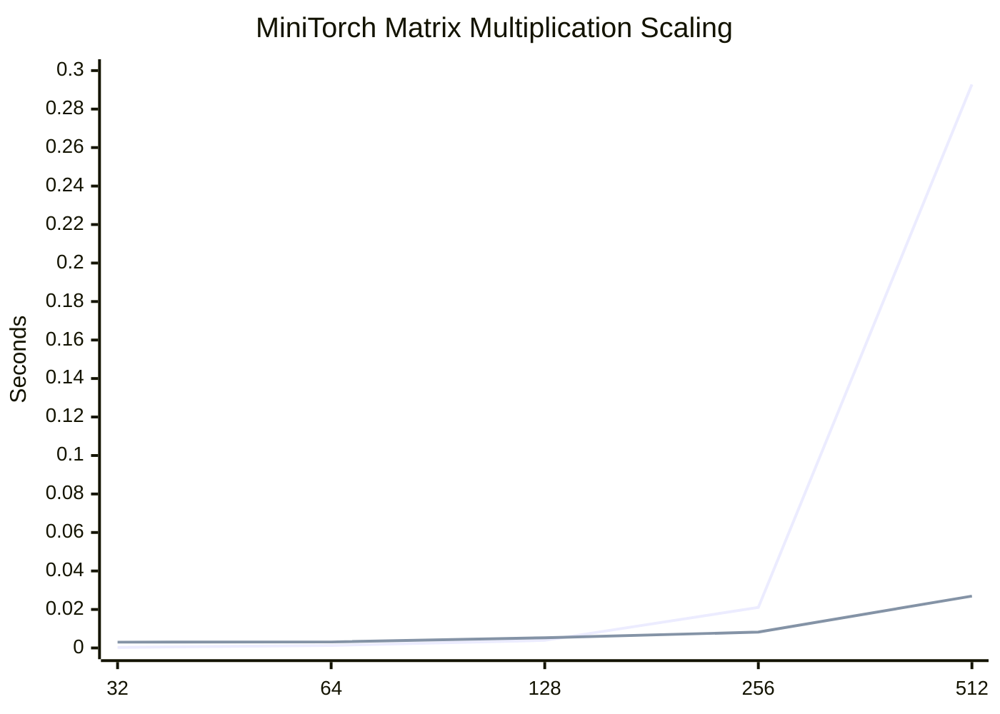

# MiniTorch

MiniTorch is a PyTorch-style deep learning framework built from scratch in Python. It reimplements the core layers of modern ML systems: scalar autodiff, tensor storage, broadcasting, optimized CPU tensor kernels, CUDA kernels, neural-network modules, and end-to-end training loops.

The goal is not to outperform PyTorch. The goal is to understand what PyTorch is doing underneath: how computation graphs are built, how gradients flow backward, how tensor shape/stride metadata works, and how backend kernels make tensor programs fast.

## Engineering extension (November 2026)

The runtime now includes direct matrix-multiply dense layers, adaptive serial/parallel
CPU kernels, persistent CUDA storage, metadata-only tensor views, and a `no_grad()`
inference context. CUDA matrix multiplication and long reductions have new numerical
regression tests. A matched float64 training benchmark checks every final parameter
against PyTorch before reporting timings.

On the local 10k-point XOR / three-epoch / float64 benchmark (median of three
measured runs after warmup):

| Backend | Original engine | Optimized engine | Improvement |
| --- | ---: | ---: | ---: |
| MiniTorch CPU | 49.136 s | 0.297 s | 165.5× |
| MiniTorch CUDA | 30.019 s | 0.808 s | 37.1× |
| PyTorch CPU reference | 0.024 s | 0.028 s | Measured in each session |

Optimized MiniTorch CPU is about 10.6× slower than the PyTorch CPU reference on
this workload. All final parameters agree within 1.11e-16 absolute error.
These are workload-specific, fixed-step results; see the linked methodology and
raw records before reusing the figures.

The project is installable as a wheel and exposes `minitorch train`, `evaluate`, and
`benchmark`. Training records include configuration, validation metrics, and portable
NPZ checkpoints. See [runtime design](docs/ARCHITECTURE.md),
[performance evidence](docs/PERFORMANCE.md), and [contributing](CONTRIBUTING.md).

The original five course modules follow the [MiniTorch curriculum](https://minitorch.github.io/).
The runtime optimization, validation harness, checkpoint format, CLI, and package CI
are additional engineering work. The historical measurements below are retained for
traceability and describe the earlier revision, not this updated runtime.

## Highlights

- Built reverse-mode automatic differentiation from first principles.
- Implemented scalar and tensor abstractions with operator overloading.
- Added broadcasting-aware tensor operations, reshaping, permutation, reductions, and batched matrix multiplication.
- Implemented Numba-optimized CPU kernels for map, zip, reduce, and matrix multiply.
- Implemented CUDA tensor kernels, including shared-memory matrix multiplication.
- Built neural-network primitives such as ReLU, sigmoid, softmax, log-softmax, pooling, and dropout.
- Trained small MLPs on nonlinear classification datasets using the MiniTorch engine.

## Historical Performance Snapshot (June–September 2026)

Detailed methodology, raw timings, timing breakdowns, and CUDA limitations are
kept in the [Benchmarks](#benchmarks) section.

| Signal | Result | Why It Matters |
| --- | --- | --- |
| Matrix multiply scaling | Historical timing ratio: 10.86x at 512x512 versus MiniTorch fast CPU | Speedup claim withheld: larger CUDA outputs fail sampled correctness checks; see validation audit below |
| 10k-point MLP training | Recorded MiniTorch CUDA: 24.3043s vs MiniTorch fast CPU: 25.4046s | 4.33% lower median elapsed time for the specified 3-epoch benchmark; two measured runs |
| PyTorch baseline | PyTorch CPU remains far faster: 0.0829s on the same 10k MLP workload | Keeps the comparison honest against production-grade kernels |



The [2026-09-30 validation audit](#validation-audit-2026-09-30) records the numerical
checks and limits on using these historical timings as resume claims.

## Why This Project Matters

Most ML projects show that you can use a framework. MiniTorch shows that you understand how a framework works.

This project is most relevant for:

- Machine learning engineering
- ML systems and infrastructure
- Deep learning systems
- Performance-oriented software engineering

It demonstrates practical understanding of autodiff, tensor layouts, backend abstraction, kernel optimization, correctness testing, and training behavior.

## Architecture

MiniTorch is organized as a staged framework build:

| Stage | Focus | Main Ideas |
| --- | --- | --- |
| Module 0 | Foundations | Mathematical operators and higher-order functional primitives |
| Module 1 | Scalar autodiff | Computation graphs, topological sorting, chain-rule backpropagation |
| Module 2 | Tensor engine | Storage, shapes, strides, broadcasting, tensor operations |
| Module 3 | Performance backends | Numba CPU kernels and CUDA kernels |
| Module 4 | Neural networks | Pooling, dropout, softmax, MLP/CNN-style training demos |

## Repository Structure

```text
minitorch/     # Core framework implementation
tests/         # Correctness tests for operators, autodiff, tensors, modules, conv, and NN ops
examples/      # Small training demos and runnable examples
benchmarks/    # Backend/parallelism comparison utilities
demo_app/      # Interactive demo-facing helpers and interfaces
archive/       # Earlier course milestones kept for reference
docs/          # Supporting documentation/assets
```

## Core Components

| File/Area | Purpose |
| --- | --- |
| `minitorch/operators.py` | Scalar mathematical primitives |
| `minitorch/autodiff.py` | Backpropagation utilities and topological sorting |
| `minitorch/scalar.py` | Scalar value object with autodiff history |
| `minitorch/tensor_data.py` | Tensor storage, indexing, shapes, and strides |
| `minitorch/tensor_ops.py` | Backend-agnostic tensor map/zip/reduce operations |
| `minitorch/fast_ops.py` | Numba-optimized CPU tensor backend |
| `minitorch/cuda_ops.py` | CUDA tensor backend |
| `minitorch/nn.py` | Neural-network operations such as pooling, dropout, and softmax |
| `minitorch/module.py` | Module and parameter abstractions |

## Installation

Use Python 3.11 or 3.12 (the versions configured in CI). From the repository root:

```bash
python -m venv .venv
source .venv/bin/activate
python -m pip install -e ".[dev]"
```

On Windows PowerShell:

```powershell
python -m venv .venv
.\.venv\Scripts\Activate.ps1
python -m pip install -e ".[dev]"
```

Runtime-only installation is `python -m pip install .`; development tools and
PyTorch are optional. For benchmarks, add the benchmark extra. For CUDA, an NVIDIA
GPU and compatible CUDA driver/toolkit are required; CPU usage does not require them.

```bash
python -m pip install -e ".[benchmark]"
python -m pip install -e ".[cuda]"
python -m pip install -e ".[demo]"
```

`requirements.txt` preserves the older course environment; package dependencies
and optional extras are declared in `pyproject.toml`.

## Train, save, and evaluate

```bash
minitorch train --dataset xor --points 1000 --hidden 16 --epochs 100 --checkpoint artifacts/xor.npz --report artifacts/xor-training.json
minitorch evaluate artifacts/xor.npz --points 1000
minitorch benchmark --backends cpu torch --output artifacts/benchmark.json
```

Use `python -m minitorch` if the console command is not on your PATH. Add
`--backend cuda` to training/evaluation or `--backends cpu cuda torch` to the
benchmark to use CUDA. The default training, validation, and test seeds are
1337, 1338, and 1339. Every example is evaluated, including a partial final batch.
Checkpoints contain weights and JSON metadata; they do not use pickle.

The benchmark matches initialization, data, batch order, float64 precision,
SGD, loss, and CPU thread counts. It excludes compilation/warmup and validates
the result of every run. See [methodology and raw records](docs/PERFORMANCE.md).

To build distributable artifacts:

```bash
python -m build
python -m pip install dist/minitorch-0.6.0-py3-none-any.whl
```

## Running Tests

Run the full correctness suite:

```bash
pytest
```

Run targeted suites:

```bash
pytest tests/test_autodiff.py
pytest tests/test_tensor.py
pytest tests/test_nn.py
pytest tests/test_conv.py
```

The tests cover gradient correctness, scalar/tensor operations, broadcasting, tensor indexing, modules, neural-network utilities, and convolution behavior.

The November 2026 local verification passed 252 tests with four existing expected
failures; a separate CPU/CUDA run passed 163 backend/reference tests on the actual
GPU. The installed wheel passed training, checkpoint evaluation, and benchmark
smoke checks. See [verification details](docs/PERFORMANCE.md#local-verification).
GitHub Actions passed all five jobs on November 24, 2026: Windows/Linux CPU tests
and installed-wheel checks on Python 3.11/3.12, plus PyTorch reference comparisons.
See the [verified CI run](https://github.com/DavidQifongJiang/MiniTorch/actions/runs/45477282622).

CUDA backend tests are opt-in so the default suite works on machines without a reliable CUDA context:

```bash
MINITORCH_RUN_CUDA_TESTS=true pytest tests/test_tensor_general.py
```

On Windows PowerShell:

```powershell
$env:MINITORCH_RUN_CUDA_TESTS="true"
pytest tests/test_tensor_general.py
```

## Running Examples

Train a small tensor-based MLP:

```bash
python examples/train_mlp.py
```

Run the scalar MLP demo:

```bash
python examples/scalar_mlp_demo.py
```

Run the MNIST CNN-style demo if the optional dataset dependency and MNIST files are available:

```bash
python examples/mnist_cnn_demo.py
```

## Benchmarks

For new measurements, use `minitorch benchmark` and the
[current performance report](docs/PERFORMANCE.md). The remainder of this section
is the historical benchmark record and audit for revision `836e9e2`.

Benchmark claims should be tied to the standard methodology in
[`benchmarks/BENCHMARKS.md`](benchmarks/BENCHMARKS.md). The local benchmark record
for the primary development machine is
[`benchmarks/results/local_i9_12900h_rtx3070ti.md`](benchmarks/results/local_i9_12900h_rtx3070ti.md).

Current measured CPU/PyTorch results from the standard local benchmark environment:

| Workload | Backend | Config | Median Time |
| --- | --- | --- | --- |
| MLP training | MiniTorch fast CPU | simple, 250 points, hidden=10, batch_size=10, 25 epochs | 3.6311s |
| MLP training | PyTorch CPU fair mini-batch | simple, 250 points, hidden=10, batch_size=10, 25 epochs | 0.2016s |
| MLP training | MiniTorch fast CPU | split, 250 points, hidden=10, batch_size=10, 25 epochs | 3.6641s |
| MLP training | PyTorch CPU fair mini-batch | split, 250 points, hidden=10, batch_size=10, 25 epochs | 0.2040s |
| MLP training | MiniTorch fast CPU | xor, 250 points, hidden=10, batch_size=10, 25 epochs | 3.6415s |
| MLP training | PyTorch CPU fair mini-batch | xor, 250 points, hidden=10, batch_size=10, 25 epochs | 0.1964s |

Latest CUDA validation on the RTX 3070 Ti Laptop GPU:

| Dataset | MiniTorch fast CPU | MiniTorch CUDA | PyTorch CPU |
| --- | ---: | ---: | ---: |
| simple | 0.2882s | 6.0520s | 0.0174s |
| split | 0.2911s | 6.0108s | 0.0166s |
| xor | 0.2894s | 5.9098s | 0.0160s |

The CUDA backend is functionally validated in a dedicated `minitorch-cuda`
environment, but it is slower for this small MLP workload. That result is
expected for this implementation because training launches many small kernels
and still pays host/device transfer overhead. The benchmark is used to study
backend behavior, not to claim GPU speedup.

With a larger MLP workload (`points=1000`, `hidden=64`, `batch_size=100`),
MiniTorch CUDA narrows the gap but still does not beat MiniTorch fast CPU:

| Dataset | MiniTorch fast CPU | MiniTorch CUDA | PyTorch CPU |
| --- | ---: | ---: | ---: |
| xor | 3.2728s | 6.3295s | 0.0171s |

With benchmark-only preloaded batches and evaluation disabled during timing, the
recorded 10,000-point XOR run has a slightly lower elapsed time on MiniTorch CUDA:

| Dataset | Config | MiniTorch fast CPU | MiniTorch CUDA | PyTorch CPU |
| --- | --- | ---: | ---: | ---: |
| xor | points=10000, hidden=64, epochs=3, batch_size=1000, preloaded batches | 25.4046s | 24.3043s | 0.0829s |

Timing breakdown shows that loss/backward dominates this workload. MiniTorch CUDA
spends less time in loss/backward than MiniTorch fast CPU, but still pays extra
forward/optimizer overhead. A full-batch CUDA run at `batch_size=10000` currently
fails with an assertion, so the safe claim is limited to the validated 1,000-item
batches above.

Historical matrix multiplication timings are preserved below. The ratios are
elapsed-time ratios, not validated speedups; see the subsequent correctness audit.

| Matrix Size | MiniTorch fast CPU | MiniTorch CUDA | CUDA vs MiniTorch CPU |
| ---: | ---: | ---: | ---: |
| 32 | 0.000294s | 0.003012s | 0.10x |
| 64 | 0.001335s | 0.003107s | 0.43x |
| 128 | 0.003955s | 0.005294s | 0.75x |
| 256 | 0.021037s | 0.008230s | 2.56x |
| 512 | 0.292770s | 0.026949s | 10.86x |

The historical CUDA times become lower than MiniTorch fast CPU at larger sizes,
but the numerical failures below prevent using that observation as a claim of
faster correct matrix multiplication. The recorded PyTorch CPU baseline is faster
than both MiniTorch backends.

### Validation audit (2026-09-30)

Reviewed revision: `836e9e2b26905b8765a4a75c4852d15defac8b45`. This audit adds
evidence; it does not change the framework or rerun the historical timing suite.

The resume values match the saved JSON records:

| Measurement | Exact recorded median | Resume rounding / interpretation |
| --- | ---: | --- |
| 512x512 MiniTorch fast CPU matmul | 0.292770299998665s | 292.77ms |
| 512x512 MiniTorch CUDA matmul | 0.026948700000502868s | 26.95ms; CPU/CUDA ratio = 10.863986x, rounded to 10.86x |
| 10k-point XOR MLP, MiniTorch fast CPU | 25.404598350001834s | 25.40s |
| 10k-point XOR MLP, MiniTorch CUDA | 24.304328700000042s | 24.30s; 4.330986% lower time, or 1.04527x |

Sources: [matmul raw results](benchmarks/results/local_i9_12900h_rtx3070ti_matmul_scaling_2026_06_04.json)
and [MLP raw results](benchmarks/results/local_i9_12900h_rtx3070ti_mlp_10k_preloaded_xor_2026_06_04.json).
The matmul record uses five measured runs after one warmup. The MLP record uses two
measured runs after one warmup, XOR, 10,000 points, hidden size 64, three epochs,
batch size 1,000, preloaded batches, and evaluation disabled. These are local
measurements on an i9-12900H / RTX 3070 Ti Laptop GPU. The 10.86x denominator is
MiniTorch fast CPU, not PyTorch. The files were recorded in June 2026, after the
proposed September 2024-February 2025 project date range.

Fresh verification results:

| Check | Observed result | Scope |
| --- | --- | --- |
| `.venv/Scripts/python.exe -m pytest -q` | 224 passed, 4 xfailed in 104.61s | Default suite; CUDA is opt-in. Two pytest cache permission warnings. |
| CUDA runtime probe | Healthy; result 2.0 | Actual device transfer and kernel launch on RTX 3070 Ti Laptop GPU |
| CUDA `test_mul_practice4`, `test_mul_practice5`, `test_mul_practice6` | 3 passed, 114 deselected in 7.41s | Existing 33x33 and rectangular/batched cases; nine warnings |

The default suite used pytest 8.3.2, Hypothesis 6.54.0, NumPy 2.0.0, and Numba
0.60.0. CUDA checks used the dedicated `minitorch-cuda` environment; its versions,
timestamp, and every checked output are saved in the
[sampled CUDA correctness record](benchmarks/results/resume_audit_cuda_samples_2026_09_30.json).
The broader CUDA test invocation was interrupted during this review, so no full
CUDA-suite pass count is claimed here.

Independent numerical checks used the benchmark's exact deterministic matrix
formula, `A[r,c] = B[r,c] = ((r*131+c*17)%97)/97.0`. Expected values were computed
with Python dot products. For each size `n`, rows and columns came from the unique
sorted set `{0, 1, min(31,n-1), min(32,n-1), n//2, n-1}`. The absolute error
tolerance was 0.01, matching the existing tensor test comparison threshold.

| Matrix size | Sampled entries | Entries exceeding tolerance | Maximum absolute error |
| ---: | ---: | ---: | ---: |
| 32 | 16 | 0 | 1.78e-15 |
| 64 | 25 | 0 | 3.55e-15 |
| 128 | 36 | 3 | 0.551812 |
| 256 | 36 | 15 | 0.677224 |
| 512 | 36 | 17 | 0.936975 |

**Do not use the 10.86x figure as a validated resume speedup until CUDA matmul
correctness is repaired and the benchmark is rerun.** Passing sampled entries at
smaller sizes does not establish correctness for every entry or workload. The
current CUDA/tensor source is unchanged from the historical matmul benchmark
commit `253640d2b7b411fb9b41e973cf818726d751bf27`. The tile loop in
[`cuda_ops.py`](minitorch/cuda_ops.py) synchronizes after loading shared memory but
has no barrier between finishing the dot products and overwriting the next tile;
this is a suspected race requiring investigation, not a confirmed repair.

Two additional measurement limits matter. Numba diagnostics serialize the row
and column loops in [`fast_ops.py`](minitorch/fast_ops.py), leaving only the batch
loop parallel; a single square matrix has one batch. Also, observed CUDA inputs
and outputs are host NumPy arrays and Numba reports host/device copy overhead.
Despite the historical record's label, the timed `left @ right` path is not a
transfer-free, pure-kernel measurement. The benchmark discards its output without
checking numerical correctness.

The MLP timing is a separate historical result: its linear layers use broadcasted
multiplication and reduction rather than the tiled matmul kernel. The matmul
failure does not by itself invalidate the recorded MLP elapsed times. Describe
the 25.40s to 24.30s result as this specific three-epoch timing experiment, not
time to convergence, equal final accuracy, or a general GPU training speedup.

The implementation supports stronger scope wording than "five modules": scalar
and tensor autodiff, shape/stride-aware storage, broadcasting-aware gradients,
CPU/CUDA tensor kernels, differentiable 1D/2D convolution, pooling, dropout, SGD,
and pytest/Hypothesis finite-difference checks. The five modules are course
milestones. Avoid a full-MNIST accuracy claim from the archived `16/16` logs: the
demo evaluates one 16-example batch, and its dropout condition uses `self.mode`
while the module API sets `self.training`.

### Possible reasons for the PyTorch performance gap

Code inspection identifies the following likely contributors. Their individual
runtime contributions have not been isolated with controlled experiments.

| Difference | Evidence and likely effect |
| --- | --- |
| Linear-layer implementation | MiniTorch's benchmark uses broadcasted multiplication followed by reduction; PyTorch uses `x @ weight`. For batch size 1,000 and a 64-to-64 hidden layer, MiniTorch materializes 4,096,000 float64 products (32.768 MB) before reduction. PyTorch's matrix multiplication avoids this full product tensor. |
| Arithmetic precision | MiniTorch stores float64; the PyTorch MLP uses float32. MiniTorch therefore needs twice the storage per value. This mismatch applies to the MLP comparison; the separate matmul benchmark explicitly uses float64 for PyTorch too. |
| Native CPU kernels | The installed `torch 2.12.0+cpu` build reports Intel oneAPI MKL, OpenMP, AVX2, and 14 intra-op threads. These provide optimized native math facilities; MiniTorch implements general-purpose indexing and reductions itself. The current thread count was checked during the audit and was not recorded in the original timing files. |
| GPU transfer and synchronization overhead | MiniTorch's tensor/view paths can copy data between host and device. The trainer explicitly synchronizes after forward, backward, and optimizer phases and launches separate kernels for elementary operations. Preloading batches does not eliminate these internal costs. |
| Autodiff and allocation overhead | MiniTorch traverses the graph in Python and creates many tensor objects and temporary buffers. `Tensor.requires_grad_(False)` currently still assigns a history, so intended non-gradient inputs also participate in graph tracking. These are additional candidate costs, not quantified explanations of the entire gap. |
| CPU matmul parallelism | For the standalone matmul benchmark, Numba diagnostics show only the batch loop remains parallel. A single matrix supplies one batch; the row and column loops are serialized. This does not explain the benchmark MLP directly, because that trainer uses multiply/reduce linear layers. |

The relevant implementations are
[`run_fast_tensor.py`](benchmarks/run_fast_tensor.py),
[`run_torch.py`](benchmarks/run_torch.py), and
[`tensor.py`](minitorch/tensor.py).
PyTorch's [performance tuning guide](https://docs.pytorch.org/tutorials/recipes/recipes/tuning_guide)
also discusses kernel-launch, memory-traffic, and synchronization costs.
This benchmark uses eager PyTorch CPU; it does not use `torch.compile`, cuBLAS,
cuDNN, or PyTorch CUDA. Those features should not be credited for these results.

A controlled comparison would match dtype, linear-layer formulation, gradient
requirements, initialization, learning rate, and thread settings, then measure
the effects of device residency and synchronization separately. The current
measurements establish an implementation-specific runtime gap, not equal time
to convergence or an isolated measure of hardware capability.

Run backend diagnostics:

```bash
python benchmarks/parallel_check.py
```

Check CUDA runtime health:

```bash
python benchmarks/cuda_health.py --markdown
```

Run the PyTorch comparison trainer:

```bash
python benchmarks/run_torch.py
```

Run the standardized benchmark suite:

```bash
python benchmarks/run_all.py --runs 5 --warmups 1 --epochs 25 --points 250 --hidden 10 --batch-size 10 --datasets simple split xor
```

Run the CUDA validation benchmark:

```bash
python benchmarks/run_all.py --include-cuda --runs 3 --warmups 1 --epochs 5 --points 100 --hidden 10 --batch-size 10 --datasets simple split xor
```

Run a larger MLP benchmark with preloaded batches and timing breakdown:

```bash
python benchmarks/run_all.py --include-cuda --runs 2 --warmups 1 --epochs 3 --points 10000 --hidden 64 --batch-size 1000 --datasets xor --preload-batches --skip-eval --collect-timing
```

Run matrix multiplication scaling:

```bash
python benchmarks/run_matmul_scaling.py --include-cuda --include-torch --runs 5 --warmups 1 --sizes 32 64 128 256 512
```

Benchmark results depend on hardware, Python version, backend availability, tensor size, and warmup behavior. The benchmark numbers above should be treated as project-scale measurements rather than universal claims.

## Interview Talking Points

Useful ways to explain this project:

- I rebuilt reverse-mode autodiff from scalar graphs to tensor graphs.
- I implemented shape/stride-aware tensor storage instead of treating tensors as plain nested lists.
- I validated gradients using derivative checks and nonlinear training tasks.
- I compared naive and optimized tensor backends and saw performance improve as tensor sizes grew.
- I connected low-level backend design to visible training behavior.

## Limitations

MiniTorch is an educational ML systems framework. It is not intended to replace PyTorch for production training. The value of the project is in the implementation depth: autodiff mechanics, tensor abstraction, backend kernels, correctness tests, and systems-level understanding.

## License

This project is released under the MIT License.
